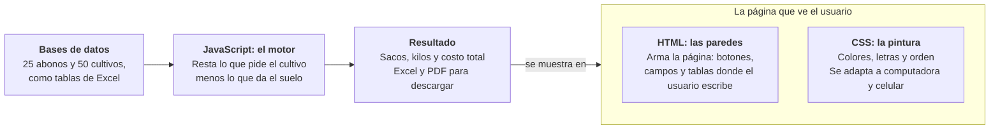

# FertiManabí: cómo se hizo

24 de octubre de 2026

## Qué es

FertiManabí es una página web que te dice cuánto abono necesita un cultivo de Manabí por hectárea y cuánto dinero vas a gastar. Se abre gratis desde cualquier navegador, en computadora o celular: [lesquel.github.io/fertimanabi](https://lesquel.github.io/fertimanabi/).

Está pensada para estudiantes y agricultores que tienen un análisis de suelo y quieren saber qué comprar sin hacer las cuentas a mano.

## Cómo se usa

El usuario hace tres pasos y el resultado aparece al instante, sin apretar ningún botón de calcular.

1. Elige el cultivo (por ejemplo, cacao) y cuántas hectáreas tiene.
2. Escribe los números de su análisis de suelo: nitrógeno, fósforo, potasio y, si lo tiene, el pH.
3. Elige qué abonos va a comprar (por ejemplo, urea).

A la derecha ve lo que falta, cuántos sacos comprar y el costo total.

## Cómo calcula

La app usa la Ley de Liebig: lo que pide el cultivo menos lo que ya tiene el suelo es lo que hay que poner con abono. Es como llenar un tanque: si necesita 120 litros y ya tiene 52, faltan 68.

Ejemplo real con 1 hectárea de cacao y nitrógeno:

| Paso | Valor |
| --- | --- |
| Lo que pide el cacao | 120 kg |
| Lo que ya tiene el suelo | 52 kg |
| Lo que falta | 68 kg |
| La urea trae 46 % de nitrógeno, entonces hay que comprar | 147,8 kg (3 sacos) |
| Costo a $32 el saco de 50 kg | $94,61 |

Lo mismo se hace con el fósforo y el potasio, y al final se suma todo. Si un abono trae dos nutrientes a la vez, la app lo descuenta para no comprar de más.

## Con qué se construyó

La app está hecha con solo tres archivos de texto y dos listas de datos. No necesita servidor ni instalar nada: todo funciona dentro del navegador.

Si la app fuera una casa, el HTML serían las paredes, el CSS la pintura y el JavaScript la instalación eléctrica que hace que todo funcione.

## Las dos bases de datos

Una base de datos aquí es simplemente una lista ordenada, como una tabla de Excel, guardada dentro de la app.

| Base | Cuántos | Qué guarda de cada uno |
| --- | --- | --- |
| Fertilizantes | 25 | Nombre, porcentaje de nitrógeno, fósforo y potasio, y precio del saco de 50 kg |
| Cultivos de Manabí | 50 | Altitud, temperatura, lluvia, pH y tipo de suelo que necesita, y cuánto nitrógeno, fósforo y potasio pide por hectárea |

Las dos se pueden ver dentro de la app, en las pestañas Fertilizantes y Cultivos. Los precios se pueden cambiar por los del almacén de cada uno.

## Extras

Además del cálculo principal, la app trae cinco ayudas:

- **Comparar fórmulas:** prueba unas 4 000 combinaciones de los 25 abonos y muestra las 5 más baratas. Con un botón se usa la elegida.
- **Encalado:** si el pH del suelo está muy bajo (ácido), calcula cuánta cal echar y la suma al costo.
- **Descargar Excel:** un archivo con el resultado, la comparación y las dos bases de datos.
- **Descargar PDF:** un reporte listo para imprimir o entregar.
- **Historial:** guarda los cálculos en el mismo navegador para abrirlos otro día, sin crear cuenta.

## Dónde está y cómo se probó

El código está guardado en GitHub, un sitio público donde se almacenan proyectos de software: [github.com/lesquel/fertimanabi](https://github.com/lesquel/fertimanabi). GitHub Pages, un servicio gratis de GitHub, lo publica como página web.

Se subió en tres entregas: la calculadora, luego el Excel, y al final la comparación, el encalado y el PDF.

Para probarla se abrió en un navegador automático, en tamaño de computadora y de celular. Se revisaron las cuentas a mano (el ejemplo del cacao da igual que la app) y se comprobó que el Excel y el PDF salen completos y sin errores.

## Límites

- Los precios y los requerimientos de los cultivos son valores de referencia. Antes de usarlos en campo conviene revisarlos con un agrónomo o con datos del INIAP.
- La comparación solo mira el precio. Por eso puede recomendar roca fosfórica, que es barata pero tarda en hacer efecto.
- El Excel y el PDF necesitan internet para generarse.
- El historial se guarda solo en ese navegador. Si se borran los datos del navegador, se pierde.
